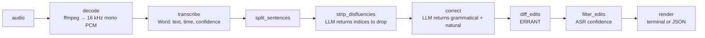

# Joel, stage 1: spoken-English correction CLI

Nov 13, 2026 · @Marcus Xavier · Status: draft for review

## Goal

A CLI that takes an audio file of me speaking English and returns every grammar mistake with the audio span (timestamps) where it happened, the sentence as I said it, the correction, and the error type.

One criterion drives every decision: **precision over recall**. Flagging a mistake that isn't there destroys trust in the feedback. The state of the art in spoken grammatical error correction catches roughly 1 in 4 errors at ~55% precision ([Qian et al., 2025](https://arxiv.org/abs/2506.18532)). Stage 1 doesn't try to beat that; it tries not to lie.

## Scope

**In**

- `joel check <audio>`: the full pipeline, report in the terminal or as JSON.
- `joel bench <dir>`: measures which transcribers preserve my mistakes, before trusting any of them.
- `joel estimate <audio>`: what the LLM steps would cost for a recording, worked out from its length alone.
- One local transcriber (Parakeet Ultra) and two cloud ones (ElevenLabs Scribe v3, OpenAI `gpt-transcribe`) behind the same interface.
- Grammar mistakes and, as a separate category, unnatural usage ("I make a party").

**Out**

- Cutting audio clips with ffmpeg: stage 1 shows timestamps only.
- HTML report with an audio player.
- Pronunciation, other languages, real-time capture.
- Audio spans for `gpt-transcribe`: it returns no word timestamps, so its report lists mistakes without times ([ADR-0007](../decisions/0007-word-timestamps-optional-in-transcriber-contract.md)).
- AssemblyAI: I have no API key for it.
- CrisperWhisper: plan B if the bench shows Parakeet normalizes my mistakes.

## Usage

```
joel check talk.m4a
joel check talk.m4a --transcriber elevenlabs --json > talk.json
joel check talk.m4a --show-uncertain
joel bench recordings/ --transcriber parakeet --transcriber elevenlabs --transcriber openai
joel estimate talk.m4a --model anthropic:claude-opus-5-5
```

| Flag | Default | Effect |
| --- | --- | --- |
| `--transcriber` | `parakeet` | `parakeet`, `elevenlabs`, `openai` |
| `--model` | `anthropic:claude-opus-5-5` | Any Pydantic AI model string |
| `--min-confidence` | `0.67` | Filter threshold (step 6); value from the Cambridge paper |
| `--show-uncertain` | off | Shows edits dropped by the filter, marked as uncertain |
| `--block-sentences` | `6` | Sentences per LLM call (steps 3 and 4); `check` and `estimate` |
| `--json` | off | Prints the full result as JSON to stdout |

`joel estimate` decodes the file only to measure how long it is. It assumes 150 words a minute and 12 words a sentence, counts two calls per block of `--block-sentences` sentences (cleanup and correction), and prices their tokens with `genai-prices`. A call's tokens are a fixed part per block, mostly the instructions, plus a part per word. Both were measured against the default model with Joel's prompts and need measuring again when a prompt changes. The estimate assumes no prompt caching and doesn't count retries, and its last line says so. `joel check` prices the tokens its calls actually used with the same function (see `render`).

## Pipeline

Each step is a pure function (apart from external calls) with JSON-serializable input and output, testable in isolation.



### 0. `decode`

System `ffmpeg` converts any input to float32 PCM, 16 kHz, mono. Parakeet requires this format; cloud adapters receive the original file.

### 1. `transcribe`

Output contract shared by every transcriber:

```python
class Word(BaseModel):
    index: int            # position in the raw transcript; never changes
    text: str             # as the ASR wrote it, punctuation attached
    start_ms: int | None      # None when the provider gives no word timestamps
    end_ms: int | None
    confidence: float | None  # 0..1; None when the provider doesn't supply it

class Transcript(BaseModel):
    transcriber: str
    words: list[Word]
```

| Transcriber | Library | Timestamps | Per-word confidence |
| --- | --- | --- | --- |
| `parakeet` (default) | `transcribe-cpp` + GGUF `handy-computer/parakeet-ultra-gguf` Q8_0 | `Word.t0_ms/t1_ms` | Minimum `Token.p` across the word's tokens |
| `elevenlabs` | `elevenlabs` SDK, `scribe_v3`, verbatim (never `no_verbatim`) | `start/end` in seconds | `exp(logprob)`; if every value is `0.0`, treat as `None` |
| `openai` | `openai` SDK, `gpt-transcribe`, `include=["logprobs"]` | None; the API returns text only | Minimum `exp(logprob)` across the word's tokens |

Measured on 2026-11-13 on this machine: Parakeet Ultra through `transcribe-cpp` 0.4.2 (wheel ships the native lib, Vulkan backend on the Intel Xe) transcribed 8.0 s of audio in 1.38 s and preserved "he go", "she don't", "there is many", "I am agree", "uh", and "the the". The audio was synthetic (`espeak-ng`), so this proves nothing about real accented speech; the bench does.

The speaking rate of a synthetic clip matters. At `espeak-ng`'s default rate (175 words per minute, 6.3 s), Parakeet wrote "I agree" and dropped the repeated "the". At `-s 130` (8.7 s) it kept every mistake, so the committed test recording, `tests/fixtures/audio/acceptance.wav`, uses 130.

The two cloud models got the same sentence on 2026-11-13 (one 9 s `espeak-ng` clip, so plumbing only). `scribe_v3` kept all four grammar mistakes, "uh", and "the, the", with word timestamps and a non-zero `logprob` on every word. `gpt-transcribe` kept the four mistakes and "uh", collapsed "the the" into "the", and heard "Yesterday" as "Yes, today". A second run on the same clip, the one saved in `tests/fixtures/openai_response.json`, heard "Yesterday" correctly and still collapsed "the the", so the mishearing varies from run to run. A prompt asking for a literal transcript didn't bring "the the" back, so the adapter sends no prompt. `gpt-transcribe` returns no word list: the adapter splits `text` on whitespace and maps token logprobs to words by character offset.

**Long audio.** Joel doesn't chunk audio itself in stage 1. Parakeet Ultra already does it internally: above 30 s, its voice-activity head cuts at the midpoint of a pause into segments of at most 30 s, decodes each independently, and stitches the text ([transcribe.cpp docs](https://github.com/handy-computer/transcribe.cpp/blob/main/docs/models/parakeet-ultra.md)). That is the same plan Handy applies (`chunking.rs`: pause cuts near 30 s, hard cap 40 s), and Handy skips its own chunker for models that report `long_form`, which Parakeet Ultra does. Cloud providers take whole files.

`gpt-transcribe` caps uploads at 25 MB. Joel doesn't split or re-encode for it in stage 1: a larger file fails with an error that names the limit.

Measured on 2026-11-13 with synthetic speech (`espeak-ng`, 0.6 s pauses between sentences, 19 known mistakes per 20 sentences), comparing the model's internal segmentation ("whole") against external cuts at sentence pauses near 30 s ("chunked"):

| Audio | Mode | Time | Mistakes kept | Words inside their sentence's span |
| --- | --- | ---: | ---: | ---: |
| 4.6 min | whole | 13.3 s | 55/57 | 99.7% |
| 4.6 min | chunked (9) | 12.8 s | 53/57 | 99.3% |
| 13.1 min | whole | 37.9 s | 143/152 | 99.6% |
| 13.1 min | chunked (27) | 37.6 s | 147/152 | 99.5% |

No consistent direction between modes, and no degradation from 4.6 to 13.1 min: the differences are a handful of sentences decoded with different neighbors. WER is omitted because it was dominated by numeral formatting ("1" vs "one"). The run also showed Parakeet normalizing my grammar on its own, in both modes: "I am agree" → "I agree", "she have" → "she has", "he make a party … last week" → "made" (5 of 8 occurrences in the whole run). That is 3–6% of mistakes erased before any LLM sees them, on clean synthetic audio.

This changes if a Whisper-family model joins (CrisperWhisper is plan B). Whisper decodes in 30 s windows, and Handy's `chunking.rs` notes accuracy loss past 30–40 s in one run. In that case chunking lives inside that model's adapter, cutting at VAD pauses as Handy does and offsetting timestamps, so the pipeline still receives plain `Word` lists.

**Model resolution.** Joel depends on no other app. It reads and writes the standard Hugging Face cache (`HF_HUB_CACHE`, or `HF_HOME/hub`, default `~/.cache/huggingface/hub`) through `huggingface_hub`, so any tool that already downloaded the same file there, Handy included, saves the download. Two constants pin the model: `PARAKEET_REVISION` (a commit hash, currently `a1539be`, the repo's `main` on 2026-11-13) and `PARAKEET_SHA256` (`007a5976…`, the file's LFS hash). Resolution order:

1. `try_to_load_from_cache(repo, file, revision=PARAKEET_REVISION)`. A hit costs no network.
2. The same repo in the cache, any revision, with a blob whose hash equals `PARAKEET_SHA256`, found through `scan_cache_dir()`. This covers files downloaded under another commit, offline included. Blob names are content hashes and `huggingface_hub` only renames a blob into place after the download completes, so a match is the exact file.
3. `hf_hub_download(repo, file, revision=PARAKEET_REVISION)`. If the blob exists, this only links it into the pinned snapshot; otherwise it downloads once. Verified with `dry_run=True` on this machine: `is_cached=True, will_download=False` for `a1539be`, whose file was cached under `39eeb55`.

If all three fail (offline, nothing cached), the CLI exits with an error naming the repo, the file, its size (740 MB), and the cache path. Moving to a new model version means bumping both constants and rerunning the bench.

Known gap: an app that keeps its Hugging Face cache somewhere else (Handy in portable mode, for example) isn't found, so Joel downloads the file once into the standard cache. A `--model-path` flag would close the gap; it stays out until someone needs it.

Cloud SDKs are optional dependencies (`joel[elevenlabs]`, `joel[openai]`).

### 2. `split_sentences`

Splits the transcript into sentences on terminal punctuation (`.`, `?`, `!`) attached to `Word.text`. All three transcribers return punctuated text. A closing quote or bracket after the mark still ends the sentence (`it."`). Words after the last mark form one more sentence, so no word is lost. Output: a list of sentences, each a list of `Word.index`.

### 3. `strip_disfluencies` (LLM)

The LLM receives a block of up to `--block-sentences` sentences as one passage of numbered words and returns **only the indices to drop**: "um/uh", repetitions, and false starts. It never rewrites text, so it cannot add or change a word, and the clean-word → `Word.index` → timestamp map stays exact. The dropped indices are then split back per sentence.

```json
{"input": [[12, "I"], [13, "went,"], [14, "I"], [15, "was"], [16, "uh"], [17, "going"]],
 "output": {"drop": [12, 13, 16]}}
```

Deterministic validation: an index outside the passage is an error and the call is retried once. If the retry is also wrong, the run stops with an error that names the passage. Dropped indices appear in `--json` for auditing.

### 4. `correct` (LLM)

One call per block of up to `--block-sentences` clean sentences (default 6), numbered, with the sentence before and after the block as context. Only the numbered sentences are corrected, each on its own ([ADR-0008](../decisions/0008-llm-steps-run-over-blocks-of-sentences.md)). Both LLM steps ask the provider to cache their tool schema and instructions, which end in worked examples so they pass Anthropic's 512-token minimum, and each step runs its first block alone so the rest read that cache ([ADR-0009](../decisions/0009-cache-the-instructions-and-warm-up-each-step.md)). Structured output, one item per number:

```json
{"sentences": [{"number": 1,
                "grammatical": "There are many people in the room.",
                "natural": "There are a lot of people in the room."}]}
```

An answer whose numbers aren't exactly 1 to n, in order, is retried once.

- `grammatical`: minimal edit, grammar only. A correct sentence comes back identical.
- `natural`: minimal edit on top of `grammatical`, only what a native speaker would find odd. If nothing sounds odd, identical to `grammatical`.

The minimal-edit instruction is the core of the prompt: LLMs tend to rewrite the whole sentence.

### 5. `diff_edits` (ERRANT)

- **Grammar mistakes**: ERRANT between the clean sentence and `grammatical`.
- **Naturalness**: ERRANT between the clean sentence and `natural`, minus edits that overlap a grammar mistake. `natural` is written on top of `grammatical`, so its diff repeats every grammar edit, and this rule is what removes the repeats. Two edits overlap when they touch the same `Word.index`, the way "do" and "n't" are one spoken word. When either edit is an insertion, they overlap when their token spans touch, which also drops an insertion right next to a grammar mistake. A few real naturalness edits get lost that way; precision comes first.

The clean sentence goes into ERRANT as text and **is tokenized by spaCy** (`tokenise=True`). Each spaCy token maps back to a `Word.index` by character offset (`token.idx`) in the string built from the words. Measured on 2026-11-13: with whitespace tokenization, "don't → doesn't" comes out as `R:PUNCT`; with spaCy ("do" + "n't") it comes out as `do → does R:VERB:SVA`, which is correct.

Edits a listener can't hear are dropped from both lists. The step compares the original and the correction by ear: it ignores case, punctuation, apostrophes and spacing, reads digits, `&` and `%` as words, and treats a short list of homophones as one word (your/you're, their/there/they're, whose/who's, to/too/two, ok/okay). A missing final period, "i → I", "Its → It's", "alot → a lot", "2 → two" and "Your → You're" all go. ERRANT sometimes splits one of these into two edits ("Your → You" plus an inserted "'re"), so a run of adjacent edits that sound the same together goes too. The transcriber chose those spellings, not the speaker, so these edits would be about the ASR. They never reach the report, `--show-uncertain` included.

ERRANT also merges a silent token into the real change next to it: "He go" against "He goes." comes out as `go → goes.` typed `R:OTHER`. So each edit first loses the silent tokens at its edges (punctuation, or a token that sounds like the one across from it), and ERRANT reclassifies what's left, which gives `go → goes R:VERB:SVA`.

Known limits: pairs that only sound alike in some accents, like then/than, still count as mistakes, and so do ordinals and decimals ("1st → first", "3.5 → 3.50"). The comparison also costs a little recall, since "were → we're" has the same letters and is dropped.

Output per edit: span in `Word.index`, original text, correction, ERRANT type, category (`grammar` or `naturalness`). An insertion has no original words, so its span is the word on each side of it, or the only neighbor at the start or end of a sentence.

### 6. `filter_edits`

Edit confidence = minimum confidence of the original words in the span; for an insertion, those are its neighbors (step 5). An edit whose confidence is strictly below `--min-confidence` is dropped from the report (probably an ASR error) and only appears with `--show-uncertain`, marked with the least confident word and its score. An edit exactly at the threshold stays. Words with `confidence = None` don't filter; the report notes that the transcriber provides no confidence.

### 7. `render`

Terminal:

```
00:12.0–00:15.1
  said:    There is many people in the room.
  correct: There are many people in the room.
           00:12.4  is → are  R:VERB:SVA   grammar

00:40.6–00:42.0
  said:    I make a party last week.
  better:  I threw a party last week.
           00:41.0  make → threw  naturalness

Cost: $0.008 for 2 model calls (1400 input and 145 output tokens) with anthropic:claude-opus-5-5.
```

There is one entry per sentence that has an edit to show, in spoken order, so a sentence with two mistakes appears once. The header is the time span of the whole sentence, dropped words included. `said:` is the clean sentence: the words `strip_disfluencies` dropped are left out, so "in the the room" reads "in the room". `correct:` is the grammatical version, followed by one line per grammar edit, and `better:` is the natural version, followed by one line per naturalness edit; a section with nothing to show is left out. Each change line starts with when its first word was said, then the edit itself, with `∅` on the empty side of an insertion or a deletion, then its ERRANT type and category. When no entry is left to show, the report says `No mistakes found.`

When the transcriber gives no timestamps (`openai`), the header and the start times are left out and the report says so once at the top. A transcriber that gives no confidence scores gets a note at the top too, since nothing could be held back as uncertain. In a transcript that has times, a sentence with a word that lacks one gets the header `--:--.-–--:--.-`, and a change on such a word starts with `--:--.-`.

Uncertain edits (step 6) are hidden by default, and a line above the cost counts them: `2 uncertain mistakes hidden; --show-uncertain shows them.` With `--show-uncertain` they appear in place, with `uncertain` at the end of their change line and an `unsure:` line under it that names the least confident word and its score.

The report ends with what the run's language model calls cost in US dollars, priced from the input and output tokens they used, retries included. Input read from the prompt cache is priced at the cache's rate, and the line says how much of the input that was: `(1650 read from cache)`. If `genai-prices` has no price for the model, the run still succeeds and the line says the cost is unknown, with the call and token counts.

`--json`: raw transcript, sentences, dropped indices, LLM corrections, every edit (including filtered ones with the reason), the run's model calls, input and output tokens with the part read from and written to the prompt cache, and its cost in US dollars (`null` when it can't be priced). The terminal report is rebuilt from this document alone, so `--show-uncertain` doesn't change it.

## `joel bench`

A directory of `NN.wav` + `NN.txt` pairs. The `.txt` holds the sentence **exactly as I said it**, mistakes included: it is the gold reference, not the correct form. Square brackets mark each of my mistakes:

```
Yesterday he [go] to school, uh, and she [don't] like it. I [am agree] with you.
```

A bracket holds one or more whole words and can't be nested. The bench strips the brackets before comparing, so they change neither the diff nor the WER. A `.wav` without its `.txt`, a `.txt` without its `.wav`, a `.txt` that isn't UTF-8, or a bracket it can't read stops the bench before any transcriber runs; it lists every such problem and exits 1.

For each transcriber and each file:

- Word-level alignment (Levenshtein, case and punctuation ignored) between transcript and gold.
- WER: substituted, deleted, and inserted words over the number of gold words.
- Mistakes kept: a bracketed mistake is kept when every word in it comes through unchanged and no word was inserted between two of its words. A word inserted at its edge, like an "uh" right before it, doesn't count. A lost mistake usually means the ASR fixed my grammar. When a transcriber drops one copy of a repeated word, the alignment always drops the first copy, so a repetition I want counted goes in brackets whole, `[the the]`; `the [the]` would still count as kept.
- Fraction of words with confidence present and above zero.
- Timestamps: `ok` when every word has a start and an end, starts never go backwards, and no word ends after the audio does; `failed`, naming the first word that breaks a rule; `n/a` when the transcriber gives no timestamps at all.

Numbers aren't normalized, so "1" against "one" counts as a divergence. The recordings should avoid numerals, or the `.txt` should write them the way the transcribers do.

Output, per transcriber: a table with `words`, `diverging`, `WER`, `mistakes kept`, `confidence`, and `timestamps` for each file plus a total row, then one inline diff per diverging file. `[said → heard]` marks each divergence and `∅` an empty side:

```
02  he [go → went] to school in [the → ∅] the room
```

Timestamp failures and per-file errors follow the diffs. A transcriber that fails to load, or fails on one file, doesn't stop the others, but it makes the exit code 1. No LLM or ERRANT calls.

**Decision rule**: the transcriber that preserves nearly all mistakes across the ~20 sentences becomes the default. A transcriber without timestamps can't be the default; if `gpt-transcribe` wins, borrowed timestamps (ADR-0007) come back on the table. If every transcriber normalizes, stage 1 stops here and the strategy changes (CrisperWhisper verbatim × intended, more prompting, or fine-tuning).

## Dependencies

| Package | Verified version | Purpose |
| --- | --- | --- |
| `transcribe-cpp` | 0.4.2 | Local Parakeet Ultra |
| `huggingface_hub` | 1.18.0 | Resolve or download the GGUF through the standard Hugging Face cache |
| `httpx` | 0.28.1 | Comes with `huggingface_hub`; declared because model resolution catches its network errors |
| `errant` | 3.0.2 | Typed diff |
| `spacy` + `en_core_web_sm` | 3.8.18 / 3.8.0 | Required by ERRANT |
| `pydantic-ai-slim[...]` with every text-model provider extra | 2.68.0 | Steps 3 and 4, typed output; `--model` can name any of those providers |
| `genai-prices` | 0.2.3 | Token prices for `joel estimate` and for what a run cost |
| `elevenlabs` (optional) | 2.78.0 | Cloud transcriber |
| `openai` (optional) | 3.50.0 | Cloud transcriber |
| `packaging` | 25.0 | Read joel's extras from its metadata, to tell a missing extra from any other missing module |
| `ffmpeg` | system | Decode |

All installed and exercised on Python 3.13 on 2026-11-13. CLI built on stdlib `argparse`. Pydantic AI is used only for the two LLM calls, with no agents and no tools.

Environment variables: `ANTHROPIC_API_KEY`, `ELEVENLABS_API_KEY`, `OPENAI_API_KEY`.

## Testing

- Pure steps (`split_sentences`, offset mapping, `diff_edits`, `filter_edits`, `render`) with JSON fixtures.
- LLM steps with Pydantic AI's `FunctionModel` returning fixed responses, to test validation and retry without network.
- Transcriber adapters: one contract test per adapter against a recorded provider response.
- One end-to-end test with Parakeet over a fixture audio file in the repo, without a real LLM.

## Acceptance criteria

1. `joel check` on the fixture audio ("Yesterday he go to school, uh, and she don't like it. There is many people in the the room. I am agree with you.") flags the four grammar mistakes with timestamps inside the words' range, and does not flag "uh" or "the the" as grammar mistakes.
2. `joel check --json` produces a document that reconstructs the terminal report with no further external calls.
3. `joel bench` runs all three transcribers over the recordings directory and prints the preservation table.
4. Changing `--transcriber` changes no step after `transcribe`.

## Risks

| Risk | Mitigation |
| --- | --- |
| The ASR fixes my grammar before the LLM sees it; Parakeet already erased 3–6% of mistakes on synthetic audio | `joel bench` measures this before anything else; cross-check with a second transcriber is the fallback |
| `strip_disfluencies` erases a real mistake: in "I am agree", dropping "am" "fixes" the sentence | Prompt restricted to fillers, repetitions, and false starts; dropped indices auditable in JSON; the bench with the LLM on (stage 2) measures it |
| The LLM over-rewrites in `correct` | Minimal-edit prompt; ERRANT exposes large edits; review against the 20 sentences |
| Scribe `logprob` comes back zeroed (seen in `scribe_v2` docs; non-zero from `scribe_v3` on one synthetic clip) | Treated as `None`; the bench reports it |
| `gpt-transcribe` has no timestamps, and it already dropped a repeated word on synthetic audio | Its report carries no audio spans; the bench measures how much it normalizes |
| Wrong ERRANT types on contractions | spaCy tokenization with offset mapping (measured) |
| Low recall | Accepted: precision is the criterion |

## Decisions

Architectural decisions live in [`docs/decisions/`](../decisions/README.md):

- [ADR-0001](../decisions/0001-own-transcriber-interface-with-one-adapter-per-sdk.md): own `Transcriber` interface, one adapter per official SDK.
- [ADR-0002](../decisions/0002-parakeet-ultra-as-default-local-transcriber.md): Parakeet Ultra as the default local transcriber (proposed until the bench confirms).
- [ADR-0003](../decisions/0003-llm-corrects-errant-extracts-edits.md): the LLM writes the corrected sentence; ERRANT extracts the edits.
- [ADR-0004](../decisions/0004-disfluency-cleanup-via-llm-returned-indices.md): disfluency cleanup with the LLM returning indices only.
- [ADR-0005](../decisions/0005-naturalness-as-second-correction-target.md): naturalness as a second correction target.
- [ADR-0006](../decisions/0006-spacy-tokenization-with-offset-mapping.md): spaCy tokenization with offset mapping.
- [ADR-0007](../decisions/0007-word-timestamps-optional-in-transcriber-contract.md): word timestamps optional in the `Word` contract, so `gpt-transcribe` fits behind the interface.
- [ADR-0008](../decisions/0008-llm-steps-run-over-blocks-of-sentences.md): cleanup and correction run over numbered blocks of sentences, one call per block.
- [ADR-0009](../decisions/0009-cache-the-instructions-and-warm-up-each-step.md): each step's tool schema and instructions go to the provider's prompt cache, and the step's first block runs alone to write it.

Smaller choices, reversible in an afternoon:

| Choice | Reason |
| --- | --- |
| `--block-sentences` defaults to 6 | Enough to share one prompt across most of a minute of speech, small enough that a retry repeats little ([ADR-0008](../decisions/0008-llm-steps-run-over-blocks-of-sentences.md)) |
| Low-confidence edits hidden by default | Precision over recall |
| At most 8 model calls in flight, every cleanup before any correction | A correction reads its neighbors' clean text, so cleanup has to finish first; 8 keeps long recordings fast while keeping each burst of requests small |
| Each step's first block runs alone | It writes the prompt cache that the step's other blocks read ([ADR-0009](../decisions/0009-cache-the-instructions-and-warm-up-each-step.md)) |
| `claude-opus-5-5` as the default model | Available on my account; swappable via `--model` |
| Timestamps only, no clips | Clipping waits until the pipeline proves it's right |
| No chunking of our own | Parakeet segments internally at ≤30 s and cloud providers take whole files; measured no gain from external cuts |
| Inaudible edits (punctuation, case, apostrophes, spacing, common homophones, digits against number words) dropped in `diff_edits`, not marked uncertain | The transcriber wrote them, not the speaker, so no threshold makes them worth showing |
| Mistakes marked with [brackets] in bench `.txt` files | Lets the bench count mistakes kept automatically instead of me reading every diff |
